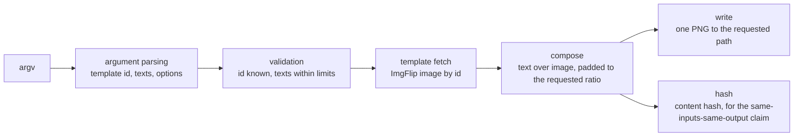

# Outline — meme-lyr

A terminal-first meme generator built on ImgFlip's public template catalogue. One
template id in, one PNG out, aspect-ratio aware and with solid-colour padding so a
caption never crops on a platform that is not square.

## The one rule

**A meme is a pure function of (template id, top text, bottom text, options).** No
network call at render time beyond fetching the template image, no stored state between
runs, no random seed. That is what makes the tool a predictable input to an agent: the
same arguments produce the same file, so a script can call it a hundred times and diff
the output. The whole tool is one TypeScript file because the rule leaves nothing else
to write.

## The shape



| Concern | Where it lives | Never does |
|---|---|---|
| the command surface and its options | `src/index.ts` | read a config file |
| template knowledge | the ImgFlip template list, fetched at call time | cache to disk |
| image composition | `sharp`, inside the render path | write outside the requested path |
| credentials | `~/.meme-lyr/config.json`, read only for the ImgFlip account if one is set | appear in the output or the logs |
| tests | `tests/` | need the network |

## How the parts wire

One file, one direction. The dependency list is short and every entry does one job:
`sharp` composites the text over the image, `axios` fetches the template, `typescript`
and `vitest` build and prove it. There are no internal modules to wire, and that is a
property of the one rule rather than an accident of the file count.

## How to check it

```
npm test
```

`vitest run`. A change to the argument surface or the padding maths needs its test
first; the tests pin the rendered output dimensions, which is the only part of this a
reader can be wrong about without noticing.

## Reading order

1. `README.md` — install, configuration, usage, exit codes, AXI compliance.
2. `src/index.ts` — the whole tool. Read it before changing anything.
3. `tests/` — what is pinned about the output.

## Note on where this repository lives

`agentic-utility/content-creation/meme-lyr`, not under `interaction-surfaces/`. It is
a content-generation tool, not a platform connector, and the earlier portfolio survey
listed it as one because the measurement corpus records it with a connector-like shape.
The directory is the authority.
